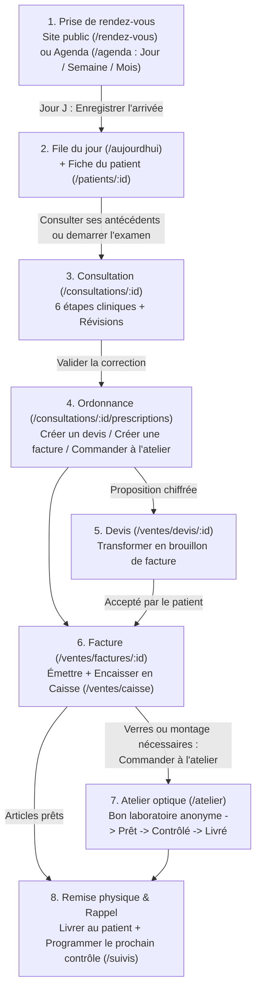
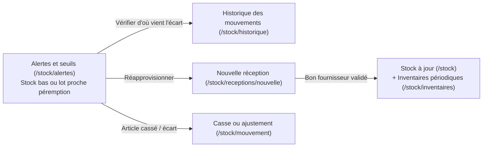

# Manuel d’exploitation du cabinet — Eagle's Eye Optics Medical

**Application en ligne :** `https://app-eagleseye.com`
**Aide intégrée à l’écran :** bouton **« Aide »** en haut à droite de chaque page et rubrique complète **`/aide`**

Ce manuel s’adresse à toute l’équipe du cabinet (**Accueil**, **Professionnel de santé**, **Caissière**, **Gérante**). Il explique avec des mots simples **comment les modules s’enchaînent du premier contact jusqu’à la remise des lunettes**, **à quoi sert chaque écran** et **que signifie chaque terme affiché**.

---

## 1. Connexion, sécurité et quatre rôles métier

Chaque membre de l’équipe dispose de son propre identifiant et ne voit dans les menus que ce qui correspond à son rôle :

| Profil | Missions principales | Ce qu’il ne voit pas / ne fait pas |
| --- | --- | --- |
| **Accueil** | Accueillir les patients, prendre et déplacer les rendez-vous (`/agenda`), enregistrer les arrivées (`/aujourdhui`), créer et fusionner les fiches patients, traiter les rappels (`/suivis`) et demandes publiques. | Ne voit ni les données cliniques (acuité, réfraction, ordonnances), ni la caisse, ni le chiffre d’affaires global. |
| **Professionnel de santé** | Consulter la file du jour, mener les examens en 6 étapes (`/consultations`), rédiger/valider les ordonnances, comparer l’évolution optique, recommander un contrôle. | Ne modifie pas la caisse, ne gère pas les comptes du personnel ni les paramètres fiscaux. |
| **Caissière** | Préparer les devis (`/ventes/devis`), créer et émettre les factures (`/ventes/factures`), ouvrir sa caisse (`/ventes/caisse`), encaisser, remettre les articles au patient. | Ne voit pas le chiffre d’affaires global du cabinet ni les caisses des autres ; ne lit pas les examens cliniques. |
| **Gérante** | Accès complet : pilotage financier, rapprochements bancaires/Mobile Money, stock, achats, inventaires, atelier optique, communication et site public, personnel, paramètres et approbations. | Certaines actions sensibles (avoirs, annulations, casse, clôture, approbations, publication site) demandent de confirmer son mot de passe. |

> **Bon réflexe au quotidien :**
> 1. **Première connexion** : passez par **Mon compte → Changer mon mot de passe** (`/mon-compte/mot-de-passe`).
> 2. **Confidentialité** : verrouillez ou déconnectez votre session lorsque vous quittez le comptoir ou le box d’examen.
> 3. **Besoin d’un coup de main sur un écran ?** Cliquez à tout moment sur **« Aide »** en haut de l’écran pour lire la fiche contextuelle de la page ouverte.

---

## 2. Vue d’ensemble : le parcours relié d’un patient de A à Z

Les modules ne sont pas isolés : chaque étape propose directement le bouton vers l’étape suivante.

### En parallèle : la boucle du stock et des achats

---

## 3. Ce que permet chaque module au quotidien

### A. Aujourd’hui (`/aujourdhui`) — La file d’attente du jour

- **Pour l’Accueil :** cliquez sur **« Enregistrer une arrivée »** (ou directement depuis la carte d’un patient sur l’Agenda le jour J) dès qu’un patient entre au cabinet. S’il n’a pas encore de fiche, créez-la d’abord.
- **Pour le Professionnel :** voyez en un coup d’œil qui attend en salle d’attente, qui est déjà pris en charge et démarrez sa consultation.

### B. Agenda et Patients à rappeler (`/agenda`, `/agenda/nouveau`, `/suivis`)

L’écran **Agenda** offre trois vues complémentaires :

1. **Vue « Jour » :** affiche heure par heure les rendez-vous d’une journée.
2. **Vue « Semaine » :** affiche du lundi au dimanche la charge de la semaine.
3. **Vue « Mois » (calendrier) :** affiche la grille mensuelle complète avec le nombre de rendez-vous sur chaque case :
   - Cliquez sur une journée du calendrier pour voir immédiatement ses rendez-vous en dessous et le bouton **« Prendre RDV ce jour »**.
   - Cliquez directement sur le bouton **`+`** d’une case du mois pour ouvrir **Nouveau rendez-vous** avec la date déjà remplie.

**Prise de rendez-vous simplifiée (`/agenda/nouveau`) :**
- Si le cabinet n’a qu’une seule ressource ou une seule prestation active, elle est **sélectionnée d’office** : les créneaux libres apparaissent aussitôt.
- Si le patient n’existe pas encore, cliquez directement sur **« Créer une fiche patient »**.
- Une fois confirmé, l’écran propose aussitôt : **« Voir l’agenda »** (à la date du rendez-vous), **« Enregistrer l’arrivée »** (si c’est aujourd’hui) ou **« Ouvrir la fiche du patient »**.

**Liens depuis chaque carte de rendez-vous :**
- Cliquez sur le **nom du patient** ou sur **« Fiche du patient »** pour ouvrir immédiatement son dossier complet.
- Quand un patient est noté **« Arrivé »**, les liens **« Voir la file du jour »** et **« Consultations »** (pour le professionnel) apparaissent directement sur la carte.

**Patients à rappeler (`/suivis`) :** centralise les relances du jour et les contrôles optiques recommandés à échéance (anniversaire d’ordonnance, adaptation lentilles).

### C. Dossier Patient (`/patients/:id`) — Le carrefour central

Depuis la fiche d’un patient, les boutons d’en-tête restent visibles sur tous les onglets (**Profil**, **Activité**, **Ordonnances**) selon vos droits :
- **« Enregistrer une arrivée »**, **« Prendre un rendez-vous »** (patient déjà choisi), **« Nouveau devis »**, **« Créer une facture »**, **« Modifier »**.

L’encart **« Accès directs du dossier »** ouvre en un clic le bon onglet ou écran filtré pour ce patient :
- **Consultations récentes** et **Ordonnances du cabinet** (`/patients/:id/activite` pré-filtré sur la section voulue),
- **Ordonnances externes**,
- **Factures du patient** et **Devis du patient**,
- **Commandes atelier** (`/atelier?patient=...`).

Dans **Activité du patient**, cliquez directement sur une **consultation**, une **ordonnance**, un **devis**, une **facture**, un **reçu** ou un **remboursement** pour ouvrir la pièce correspondante.

### D. Consultations et Ordonnances (`/consultations`)

1. **Examen en 6 étapes :** motif & équipement actuel, antécédents, acuité visuelle (échelle choisie d’office s’il n’y en a qu’une), réfraction objective et subjective (OD puis OG), examen complémentaire, conclusion et contrôle recommandé.
2. **Lien permanent vers le patient :** le bandeau supérieur de la consultation propose **« Ouvrir le dossier patient »** pour vérifier ses anciennes factures, ordonnances ou coordonnées sans perdre sa place.
3. **Fin de consultation fluide :** dès l’examen terminé, vous pouvez cliquer sur **« Transmettre à la caisse »** ou **« Créer un devis »**.
4. **Ordonnance validée :** une fois signée par le professionnel, elle propose directement trois actions commerciales et techniques : **« Créer un devis »**, **« Créer une facture »** ou **« Commander à l’atelier »**.
5. **Révisions & Comparaison (`/consultations/:id/historique`, `/patients/:id/comparaison`) :** toute correction après validation crée une révision datée et signée ; l’écran de comparaison superpose les réfractions dans le temps.

### E. Ventes, Devis, Factures et Caisse (`/ventes`)

- **Devis (`/ventes/devis`) :** permettent de chiffrer monture + verres + options sans mouvement financier ni engagement de caisse. Un devis accepté se convertit en un clic en **brouillon de facture**. Le nom du patient sur un devis ouvre sa fiche.
- **Factures (`/ventes/factures`) :**
  - **Brouillon** : modifiable (lignes, remises, taxes).
  - **Émise** : pièce officielle figée (numéro définitif, montant dû calculé). **À savoir :** l’application dit toujours *émise*, *encaissée*, *reste à encaisser* — elle n’utilise jamais *payé*, *soldé* ou *acquitté*.
- **Corrections (Avoir, Remboursement, Annulation) :** une facture émise ne se modifie jamais en silence. Un encadré **« Quelle correction choisir selon votre situation ? »** aide à trancher en 10 secondes entre :
  - **Annuler** (erreur immédiate sans encaissement ni livraison),
  - **Avoir** (réduction ou retour commercial après émission),
  - **Remboursement** (restitution financière réelle vers le patient).
- **Atelier depuis la facture :** dès qu’une facture porte des lignes d’équipement, cliquez sur **« Commander à l’atelier (lunettes) »** dans l’encart dédié ; la création de commande se pré-remplit sur cette facture.
- **Remise physique des articles (`Livraisons` sur la fiche facture) :** chaque remise d’article au patient diminue réellement le stock réservé puis physique. C’est distinct de l’encaissement : un article peut être encaissé avant d’être livré, ou remis sur accord.
- **Caisse & Finance (`/ventes/caisse`, `/ventes/caisse-du-jour`, `/ventes/finance`, `/ventes/rapprochement`) :**
  - Ouvrir sa caisse en début de journée, saisir chaque encaissement (Espèces, Carte, Mobile Money, Assurance/Mutuelle), noter les petites dépenses de caisse dans les catégories prévues, et fermer sa caisse en fin de service avec comptage réel.
  - La gérante suit l’ensemble dans **Finance du cabinet** et pointe les relevés Mobile Money / banque dans **Rapprochements par canal**. Un bouton clair **« Finance et export comptable »** (format `Q13`) prépare l’aperçu et le téléchargement CSV pour votre comptable.

### F. Stock, Fournisseurs, Réceptions et Inventaires (`/stock`)

- **Disponibilités (`/stock`) :** chaque article montre son **stock physique** (dans le tiroir), son **stock réservé** (déjà affecté à une vente non encore remise) et son **stock disponible** (libre à la vente = physique − réservé).
- **Alertes et seuils (`/stock/alertes`) :** signale les articles sous le seuil minimum et les lots proches de péremption (solutions, lentilles, collyres). Depuis chaque alerte, agissez en un clic : **« Historique des mouvements »** (article pré-filtré), **« Nouvelle réception »** ou **« Casse ou ajustement »**.
- **Fournisseurs (`/stock/fournisseurs`) & Réceptions (`/stock/receptions`) :** enregistrez vos livraisons en brouillon puis validez-les (numéro de lot, expiration et coût unitaire si suivi par lots).
- **Casse ou ajustement (`/stock/mouvement`) & Inventaires (`/stock/inventaires`) :** chaque écart est justifié par un motif et validé par la gérante.

### G. L’Atelier optique (`/atelier`) — Concrètement, c’est quoi et comment l’utiliser ?

Dans un cabinet d’optique, le patient choisit sa monture et présente sa correction au comptoir, mais ses lunettes **ne sont pas prêtes immédiatement** : les verres doivent être commandés chez le verrier/laboratoire (ou taillés et montés à l’atelier sur la monture du patient). C’est ce cycle technique que gère le module **Atelier optique**.

- **Différence avec Ventes et Stock :**
  - **Ventes / Facture** = ce que le patient achète et règle financièrement.
  - **Stock** = la quantité de montures, lentilles ou produits disponibles dans vos tiroirs.
  - **Atelier optique** = la fabrication/le montage des lunettes correctrices entre votre comptoir et votre laboratoire ou opticien-monteur.
- **Comment s’en servir au cabinet :**
  1. Créez la facture patient (ou partez d’une ordonnance validée), puis cliquez sur **« Commander à l’atelier (lunettes) »**.
  2. La commande réunit automatiquement les données techniques nécessaires (**paramètres optiques figés** de l’ordonnance, référence monture, choix de verres, laboratoire/fournisseur).
  3. Imprimez le **bon laboratoire anonymisé** : il contient uniquement un code dossier technique et les mesures optiques (jamais le nom complet ni les données médicales sensibles du patient) pour respecter le secret professionnel chez le sous-traitant.
  4. Faites progresser la commande étape par étape : **En attente → Au montage → Prêt → Contrôlé → Livré au patient**.
  5. Dès qu’elle passe **« Prêt »** puis **« Contrôlé »**, l’équipe sait qu’elle peut appeler le patient pour l’essayage et effectuer la remise finale sur la facture.

### H. Communication et Site public (`/communication`, `/showroom`, `/rendez-vous`)

Ce module relie votre vitrine publique à votre accueil interne sans jamais exposer le dossier médical sur Internet :

- **Site public : showroom & contenus (`/communication/site`) :** préparez en brouillon vos textes (accueil, horaires, adresse) et les montures mises en avant sur `/showroom`. Rien n’apparaît au public tant que la gérante ne clique pas sur **Publier** avec son mot de passe.
- **Réservations publiques & Google Agenda (`/communication/reservations`) :** recevez les demandes de rendez-vous faites par les visiteurs sur `/rendez-vous` et transformez-les d’un clic en vrai rendez-vous confirmé dans l’Agenda (ou refusez-les).
- **Prospects & CRM Kommo (`/communication/crm`) :** suivez les contacts commerciaux avant qu’ils ne deviennent patients et reliez un prospect existant à sa fiche patient quand il vient au cabinet.
- **Base de connaissances & Assistant (`/communication/connaissances`, `/communication/assistant`) :** fiches d’information validées (horaires, adresse, modalités générales) et reprise humaine si un visiteur pose une question qui nécessite un conseiller. L’assistant ne donne jamais de conseil médical.
- **Consentements, Campagnes & Boîte d’envoi (`/communication/consentements`, `/communication/campagnes`, `/communication/boite-envoi`) :** enregistrez strictement l’accord (*opt-in*) ou le refus (*opt-out*) de chaque personne avant toute relance marketing ; vérifiez dans **Boîte d’envoi & webhooks** si les intégrations externes sont à jour.
- **Connecteurs (`/parametres/integrations`) :** la gérante y saisit et teste les comptes fournisseurs (Google Agenda, Kommo, messagerie SMS/WhatsApp) grâce aux **modèles pré-remplis** disponibles en un clic. Tant qu’un fournisseur n’est pas configuré, aucun SMS/WhatsApp réel ne part chez les patients.

### I. Statistiques, Rapports et Paramètres (`/rapports/*`, `/parametres/*`)

- **Statistiques (`/rapports/statistiques`) :** tableaux de bord clairs sur l’activité d’accueil et les examens cliniques ; certains indicateurs renvoient directement vers l’**Agenda** ou **Patients à rappeler**.
- **Rapports de gestion (`/rapports/gestion`) :** synthèses exportables (activité, clinique, finance, stock, atelier). La signature technique (empreinte de contrôle du document) est repliée dans un bloc discret **« Détail de vérification technique »** pour ne pas alourdir la lecture quotidienne.
- **Paramètres (`/parametres`) :** gestion du personnel (`/parametres/personnel`), mentions légales et horaires d’impression sur les documents officiels (`/parametres/cabinet`), demandes à valider (`/parametres/approbations`), archives d’exports CSV/PDF (`/parametres/exports`).

---

## 4. Dictionnaire des termes affichés à l’écran (explication simple)

| Expression vue à l’écran | Signification concrète pour votre équipe |
| --- | --- |
| **Brouillon** | Pièce encore modifiable (facture, devis ou réception en cours de saisie). N’impacte ni la caisse ni le stock. |
| **Émise / Encaissé / Reste à encaisser** | Termes comptables officiels d’une facture validée. Remplacent *payé* ou *soldé* car un dossier peut avoir plusieurs paiements partiels, un avoir ou une assurance tiers. |
| **Avoir vs Remboursement vs Annulation** | **Annulation** : annule une facture erronée sans argent versé. **Avoir** : diminue le montant dû d’une facture déjà émise. **Remboursement** : rend réellement de l’argent au patient en caisse ou virement. |
| **Stock physique / réservé / disponible** | **Physique** = quantité sur vos étagères. **Réservé** = bloqué pour des factures non encore livrées. **Disponible** = ce que vous pouvez encore vendre maintenant (`physique − réservé`). |
| **Bon laboratoire anonymisé** | Fiche imprimée pour le verrier ou le monteur extérieur portant un numéro de commande et les corrections optiques, sans nom ni téléphone du patient. |
| **Export comptable Q13** | Synthèse comptable des ventes, taxes et encaissements par journal et mode de règlement, prête pour votre cabinet comptable. |
| **Outbox (Boîte d’envoi) & Webhook** | File d’attente technique des échanges avec des services extérieurs (CRM, messagerie, Google Agenda) et accusés de retour reçus de ces services. Utile uniquement à la gérante en cas d’incident de connecteur. |
| **Opt-in / Opt-out (Consentements)** | Accord (*opt-in*) ou refus (*opt-out*) explicite du patient/contact pour recevoir des relances ou campagnes d’information. |
| **Empreinte SHA-256** | Code de contrôle mathématique prouvant qu’un document ou un export n’a pas été altéré depuis sa création. Replié en bas d’écran. |

---

## 5. Rituels recommandés pour la gérante

### Chaque matin à l’ouverture
1. Ouvrir **Aujourd’hui** (`/aujourdhui`) et l’**Agenda** (`/agenda`) : vérifier les patients attendus du jour.
2. Vérifier **Réservations publiques** (`/communication/reservations`) si des demandes sont arrivées pendant la nuit.
3. Contrôler que la **Caisse** (`/ventes/caisse`) est ouverte avec le bon fond de caisse.

### Chaque soir à la fermeture
1. Vérifier que tous les patients enregistrés ont leur dossier ou visite correctement clôturé.
2. Fermer la **Caisse** (`/ventes/caisse`) en comptant réellement les espèces et en contrôlant Mobile Money / TPE.
3. Jeter un œil rapide à **Atelier optique** (`/atelier`) pour noter les lunettes reçues (« Prêt » / « Contrôlé ») à appeler le lendemain.

### Chaque semaine / fin de mois
1. Vérifier **Alertes et seuils** (`/stock/alertes`) et saisir les **Réceptions fournisseur** en attente.
2. Passer en revue **Patients à rappeler** (`/suivis`) et **Approbations** (`/parametres/approbations`).
3. Effectuer les **Rapprochements par canal** (`/ventes/rapprochement`) et générer l’**Export comptable Q13** pour le comptable.

---

## 6. Que faire si… (dépannage rapide)

- **« Le serveur n’a pas répondu » :** vérifiez la connexion Internet du poste, puis cliquez sur **« Réessayer »**. Tant que le serveur n’a pas confirmé, une action sensible (rendez-vous, encaissement, validation de stock) n’est pas comptée deux fois si vous la renvoyez.
- **« Aucun patient trouvé » lors de la prise de rendez-vous :** créez son dossier en un clic via **« Créer une fiche patient »** directement dans l’écran Nouveau rendez-vous.
- **« Une facture contient une erreur après émission » :** n’essayez jamais de modifier une facture émise ; utilisez l’encadré **« Quelle correction choisir ? »** sur la fiche facture (Annuler, Avoir ou Remboursement).
- **« Un produit manque dans le sélecteur d’articles ou fournisseurs » :** assurez-vous qu’il est **actif** dans **Ventes → Catalogue** (ou **Stock → Fournisseurs**), et s’il s’agit d’un article en stock, que son suivi en stock est activé sur sa fiche catalogue.
- **« Un bouton d’envoi SMS/WhatsApp reste sans effet externe » :** vérifiez avec la gérante dans **Paramètres → Intégrations et connecteurs** (`/parametres/integrations`) que les accès du fournisseur sont bien renseignés et actifs.
